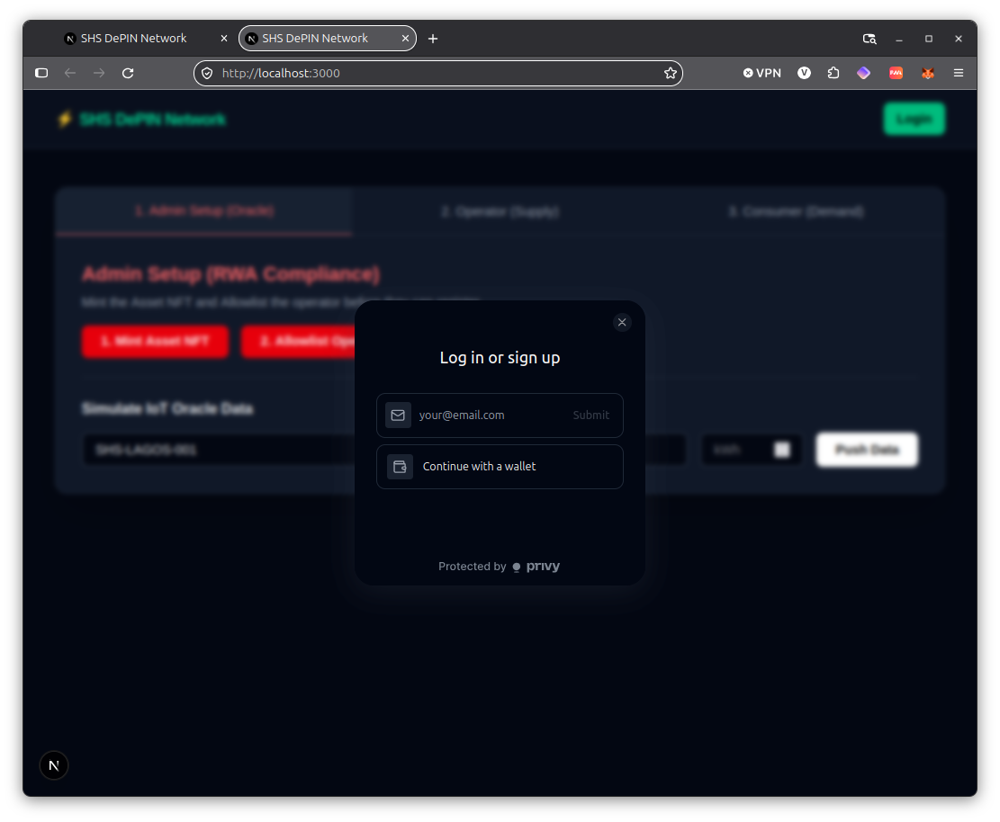
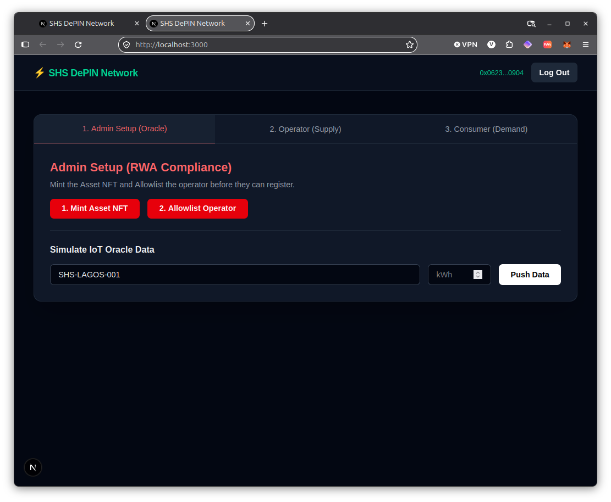
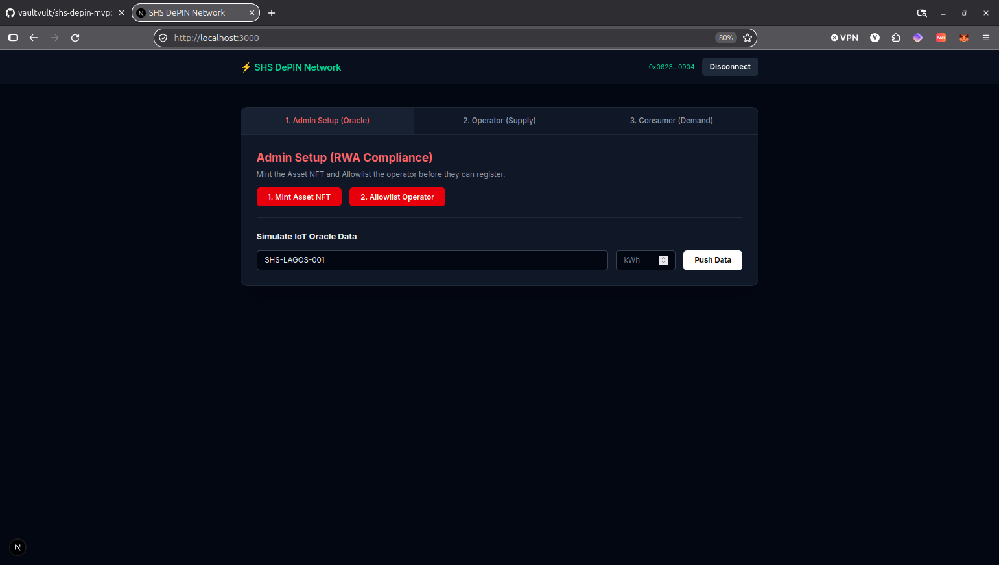
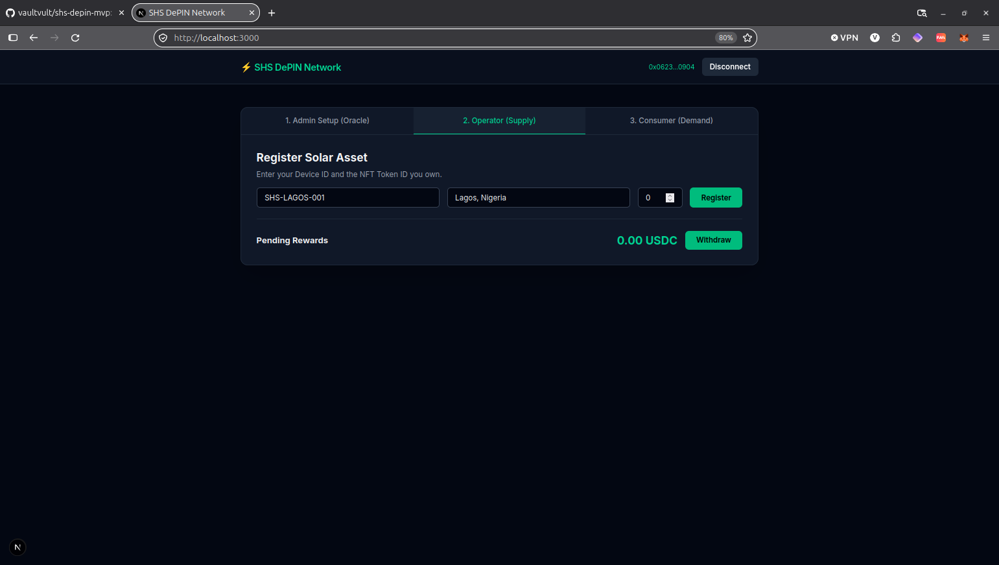
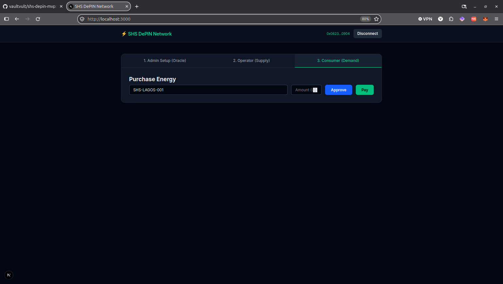

# SHS DePIN Network

A decentralized physical infrastructure network (DePIN) MVP built for the W3Node Hackathon. This protocol enables peer-to-peer energy trading and incentivization for Solar Home Systems (SHS) in Africa.

> **⚠️ Note for Judges:** The YouTube demo video shows the V1 flow. This repository contains the fully upgraded **V2 RWA-Compliant** architecture, which includes ERC-721 Asset Tokenization, an Operator Allowlist, a Device Freeze function, and **Privy integration for invisible wallets**.

## 🔐 Seamless Onboarding (Privy Integration)
To meet the "Product Design" criteria and ensure mass adoption in Africa, we integrated Privy for Web2-friendly onboarding.
* **Crypto-Native Users:** Can seamlessly connect MetaMask or Coinbase Wallet.
* **Web2 Users:** Can sign up with just an email address. Privy automatically creates a secure, invisible embedded wallet in the background.

**Login Modal:**


**Logged In (Invisible Wallet Created):**


## 📸 Application UI (V2 RWA Flow)
**1. Admin Setup (Asset Tokenization & Allowlist)**


**2. Operator Registration (NFT Verification)**


**3. Consumer Payment (Stablecoin Demand)**


## 📚 Documentation
* [Project Concept & Business Model](CONCEPT.md)
* [Technical Architecture & Security Evidence](TECHNICAL.md)

## 🏗️ Architecture Diagram

```mermaid
graph TD
    A[Consumer] -->|Pays USDC| B(EnergyMarket Smart Contract)
    C[Solar Panel Hardware] -->|Generates Data| D{IoT Oracle Simulator}
    D -->|Submit Proof of Generation| B
    B -->|Splits Rewards| E[Operator Wallet]
    E -->|Withdraw| F[External Cash/Mobile Money]
    
    subgraph BaseSepolia [Base Sepolia Testnet]
    B
    end
