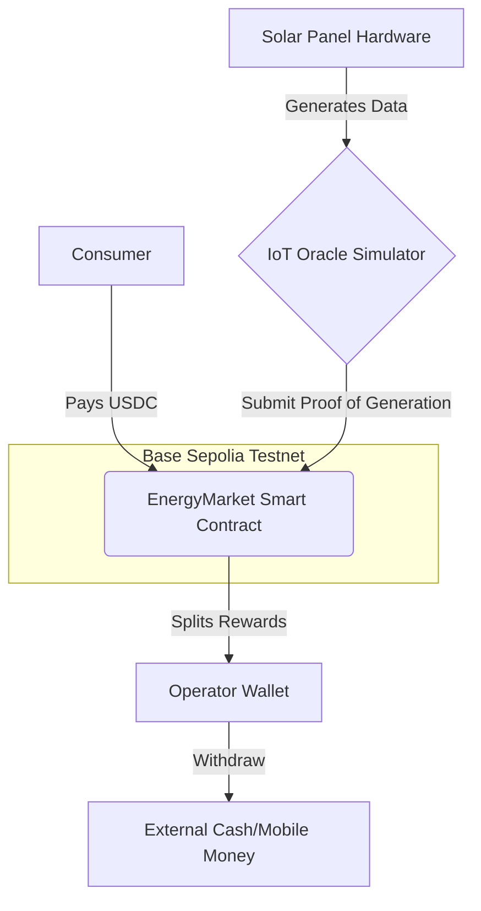

# SHS DePIN Network

**🔗 Live Deployment:** [https://shs-depin-mvp.vercel.app](https://shs-depin-mvp.vercel.app)

A decentralized physical infrastructure network (DePIN) MVP built for the W3Node Hackathon. This protocol enables peer-to-peer energy trading and incentivization for Solar Home Systems (SHS) in Africa.

> **⚠️ Note for Judges:** The YouTube demo video shows the V1 flow. This repository contains the fully upgraded **V2 RWA-Compliant** architecture, which includes ERC-721 Asset Tokenization, an Operator Allowlist, a Device Freeze function, and **Privy integration for invisible wallets**.

## 💡 How It Works (The Physical Implementation)
To understand SHS DePIN, picture a rural home in Nigeria with a **Solar Home System (SHS)** on the roof—a solar panel, a battery, and a smart meter inside the house. 

The **Operator** is the company that paid for the solar panel. The **Consumer** is the family living in the house. Because the family cannot afford the $500 upfront cost, they use a Pay-As-You-Go model facilitated by our protocol:

1. The family logs into our app (using email via Privy) and pays **5 USDC** for 10 kWh of electricity.
2. The smart contract instantly routes that USDC to the Operator's wallet.
3. The IoT smart meter (simulated by our Oracle button in the MVP) detects the payment on-chain and unlocks the electricity flow to the house.
4. **The RWA Angle:** Investors can fund the Operator's solar panels. As the family pays for their daily energy, the USDC micro-payments generate a transparent, real-world yield for the investors.

## 🔐 Seamless Onboarding (Privy Integration)
To meet the "Product Design" criteria and ensure mass adoption in Africa, we integrated Privy for Web2-friendly onboarding.
* **Crypto-Native Users:** Can seamlessly connect MetaMask or Coinbase Wallet.
* **Web2 Users:** Can sign up with just an email address. Privy automatically creates a secure, invisible embedded wallet in the background.

**Login Modal:**

**Logged In (Invisible Wallet Created):**

## 📸 Application UI (V2 RWA Flow)
**1. Admin Setup (Asset Tokenization & Allowlist)**

**2. Operator Registration (NFT Verification)**

**3. Consumer Payment (Stablecoin Demand)**

## 📚 Documentation
* [Project Concept & Business Model](CONCEPT.md)
* [Technical Architecture & Security Evidence](TECHNICAL.md)

## 🏗️ Architecture Diagram

# 🎤 SHS DePIN Network: Pitch & Q&A Master Document

This document encapsulates the business model, market fit, competitive landscape, and technical architecture of SHS DePIN Network. It serves as a comprehensive guide for judges, investors, and mentors.

## 💼 1. Business & Market Fit

**Q: How do you actually get the solar hardware to the users? Are you manufacturing panels?**
> **A:** No, we are the software rails, not the hardware manufacturers. We partner with existing mini-grid operators and solar distributors (like Sun King or M-KOPA). They already have the hardware; we provide the Web3 financial layer that allows them to accept stablecoin micro-payments and tokenize their assets for investors.

**Q: Why would an investor put money into this instead of just staking USDC on Aave?**
> **A:** Yield and stability. DeFi yields are fluctuating and speculative. Our yield is tied to a real-world essential service: energy consumption. People always need power. By investing in the SHS vault, they get a transparent, asset-backed yield that isn't correlated with crypto market volatility.

**Q: How do you acquire users (Go-to-Market)?**
> **A:** We use a B2B2C model. We don't sell directly to rural families; that requires a massive physical footprint. We sell to the Solar Operators. They integrate our smart contracts and onboard their existing customer base onto our app.

**Q: What is your revenue model?**
> **A:** We take a 1.5% protocol fee on every energy transaction. Because energy is consumed daily, this creates a high-frequency, recurring revenue stream. For the MVP, we routed 100% to the operator and investor vault to prove the flow, but the 1.5% fee is built into our V2 production architecture.

## 🛠️ 2. Technical Questions

**Q: How do you prevent someone from faking the solar energy data to drain the investor vault? (The Oracle Problem)**
> **A:** In this MVP, we used an admin-restricted simulator to prove the flow. However, the smart contract is already designed to accept external data. In production, we will integrate decentralized oracle networks like Chainlink, or use hardware secure elements (TEEs) inside the smart meters to cryptographically sign the energy data before it hits the chain.

**Q: What happens if the internet goes down in the rural village?**
> **A:** The smart meters can cache the energy data locally. When the consumer eventually connects to the internet (via mobile data or mesh networks), the meter syncs the data, and the delayed USDC payment is processed on-chain.

**Q: Why did you choose Base?**
> **A:** Base is the perfect L2 for DePIN. It offers ultra-low transaction fees (essential for 5 USDC micro-payments) and has massive liquidity via USDC. Plus, Coinbase's ecosystem makes it easier to bridge fiat to crypto for our operators.

**Q: How did you handle the Web3 onboarding UX?**
> **A:** We integrated Privy. A rural farmer doesn't know what a seed phrase is. With our app, they log in with an email, and a secure wallet is created invisibly in the background. They can pay for energy without ever knowing they are using a blockchain.

## 🥊 3. Competitive Landscape

**Q: Why won't Sun King or M-KOPA just build this Web3 layer themselves?**
> **A:** They are hardware companies; their moat is physical distribution. Building a secure, audited RWA protocol is a completely different skillset. It is much more likely that they will partner with us to use our white-label rails, rather than spend millions trying to build a Web3 team from scratch.

**Q: What about other DePINs like Arkreen or Glow?**
> **A:** Those projects focus on global carbon credits or massive utility-scale solar farms. We are hyper-local. We focus on the "Solar Home System" (rooftop panels) and the specific last-mile payment problems in Africa (USDC micro-payments, local mobile-money integration).

## 🚨 4. The "Curveball" Questions

**Q: What is the biggest risk to your project?**
> **A:** Regulatory risk. Dealing with stablecoins in Africa requires navigating local crypto laws. That's why we built on Base and use USDC—it is the most compliant stablecoin. We also ensure only KYC'd, allowlisted operators can register hardware. We are building within the lines of regulators like the NERC (Nigerian Electricity Regulatory Commission).

**Q: If I gave you $50,000 right now, what would you do with it?**
> **A:** I would use $15k to hire a top-tier smart contract auditor, $10k to purchase 10 real IoT smart meters to test hardware integration in Lagos, and the remaining $25k for a 3-month pilot program with a local solar operator to onboard 500 real users.

**Q: You have a fully working app. Why are you doing this hackathon?**
> **A:** Because building the tech is only 10% of the battle. The other 90% is distribution, partnerships, and capital. I'm here to connect with mentors, get feedback on our tokenomics, and find the right VCs to help us scale across Africa.
